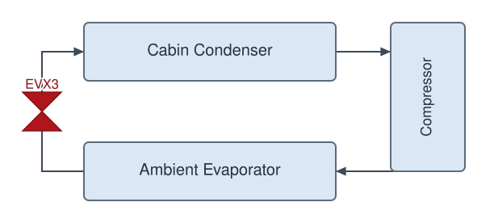
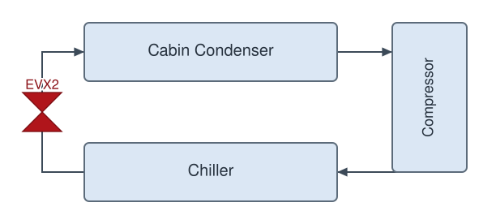

# Refrigerant circuit control concept

*The root system of `NN_Deployment.slx`, drawn block by block — click the picture to open it at
full size.*

The refrigerant circuit of a vehicle thermal-management system changes with the hardware
variant: which expansion valve feeds which heat exchanger, whether the condenser sits at the
front end or in the cabin, and whether the cold side drives the cabin evaporator, the battery
chiller, or both. The model keeps one network for every layout and a selector that decides
which layout is reported at runtime.

## What the drawing shows

**Left — the vehicle interface.** The fourteen input ports carry the air inlet temperatures and
mass flows of the front-end condenser (`KND`), the HVAC evaporator (`Verdampfer`) and the
heater register (`Heizregister`), the evaporator's outlet humidity, the battery chiller's inlet
temperature and coolant flow, the compressor speed, the commands of expansion valves EXV1 to
EXV3, and the configuration selector `TmeCtlConfsel_st_SysConfRefrCir_TmEP`. Data-type
conversion blocks next to the ports match those signals to the single/double/int32 interfaces
the networks expect.

**Middle — six configuration subsystems.** `sysconfig_1`, `_2`, `_5`, `_8`, `_9` and `_16`
stand side by side. Every one of them contains a single S-Function block (the deployed network
for that circuit), fed through a demux of its own input vector, and carries the small circuit
sketch that identifies the layout: condenser, compressor, evaporator and chiller stages and the
expansion valve(s) that belong to it. A layout only sees the sensors it actually has, which is
why the six subsystems do not have the same number of ports.

**The black vertical bars** are bus creators and bus selectors: they bundle the sensor signals
into named buses and pick them apart again, which is what keeps the root model readable at this
size.

**Right — output selection.** Fifteen multiport switches, one per output group, take the
configuration selector and pass through the outputs of the active layout. PT1 filter
subsystems smooth those signals before they reach the sixteen output ports: compressor inlet
and outlet pressure and temperature, compressor speed and electrical power, refrigerant outlet
states at the condenser and the evaporator, air outlet temperatures of the HVAC evaporator and
the heater register, and the heat flows into the front-end air, the HVAC air and the battery.

## The six layouts

| Configuration | Expansion valve(s) | Condenser | Evaporator / chiller | Network |
| --- | --- | --- | --- | --- |
| 1 | EVX3 | cabin | ambient evaporator | 6 in → 11 out |
| 2 | EVX2 | cabin | chiller | 6 in → 10 out |
| 5 | EVX1 | ambient | cabin evaporator | 7 in → 10 out |
| 8 | EVX2 | ambient | chiller | 6 in → 8 out |
| 9 | EVX2, EVX1 | ambient | cabin evaporator, chiller | 10 in → 11 out |
| 16 | EVX2, EVX1 | cabin | cabin evaporator, chiller | 13 in → 15 out |

The same circuit sketches, on their own:

### Configuration 1 — EVX3, cabin condenser, ambient evaporator

Front-end air and heater-register air on the warm side, the ambient evaporator on the cold side,
with EVX3 as the only expansion valve. Its eleven outputs cover the compressor state, the
heater register and the front-end condenser.

### Configuration 2 — EVX2, cabin condenser, chiller

The cabin condenser combined with the battery chiller. Inputs are the chiller's coolant
temperature and flow, the heater-register air side, compressor speed and the EXV2 command; the
model reports the chiller heat flow next to the compressor state.

### Configuration 5 — EVX1, ambient condenser, cabin evaporator

The condenser moves to the front end and the cabin evaporator becomes the cold side. The HVAC
evaporator's humidity is part of this network's input vector, because the cabin air outlet is
one of its outputs.

### Configuration 8 — EVX2, ambient condenser, chiller

Front-end condenser, battery chiller and a single valve, with the shortest output list of the
six (8 signals): compressor state and power, the two heat flows and the condenser outlet.

### Configuration 9 — EVX2 and EVX1, ambient condenser, cabin evaporator and chiller

Both cold-side heat exchangers in parallel, each fed by its own expansion valve, against the
front-end condenser. Ten inputs, including both valve commands; the outputs add the cabin
evaporator's air and refrigerant states to the chiller heat flow.

### Configuration 16 — EVX2 and EVX1, cabin condenser, cabin evaporator and chiller

The most complete layout: cabin condenser, both cold-side stages and the heater register, with
thirteen inputs and fifteen outputs. It is the only configuration that reports all three heat
flows — front-end air, HVAC air and battery — at once.

## Reading the signal names

Names follow the vehicle signal convention `source_medium_variable_unit`, in German.

| Part | Meaning |
| --- | --- |
| `Eintritt` / `Austritt` | inlet / outlet |
| `KND` | front-end condenser side |
| `KaelteMittelKreis` (`KaeMK`) | refrigerant circuit side |
| `Verdampfer` | evaporator (HVAC air path) |
| `Heizregister` | heater register (HVAC air path) |
| `Chiller` / `KMKBat` | battery chiller / coolant loop to the battery |
| `EXV1` … `EXV3` | expansion valve commands |
| `EKV` | electric refrigerant compressor |
| `degC`, `bar`, `kgps`, `lpmin`, `1pmin`, `W` | °C, bar, kg/s, l/min, 1/min, W |
| `1p100` | normalised value, 0…1 = 0…100 % |

## Model facts

| | |
| --- | --- |
| Systems | 140 |
| Blocks | 1,690 (168 in the root) |
| Signal segments in the root | 368 |
| Model ports | 14 inputs, 16 outputs |
| Deployed networks | 6, one per configuration |
| Source model | `NN_Deployment.slx` |

The picture at the top is the model's own root system exported as vector graphics, so every
block, wire, port marker and label is the one you see in Simulink; the circuit sketches in the
configuration sections are the drawings those subsystems carry.

---

Internal engineering documentation for the refrigerant-circuit control concept.
