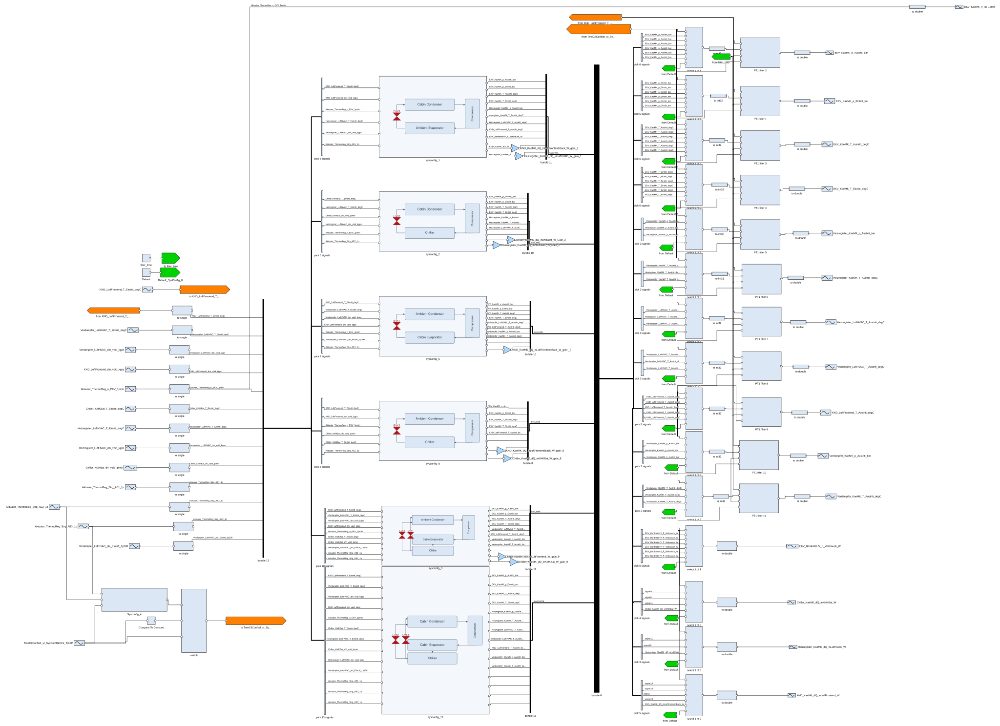

# Refrigerant circuit control concept

Open the model: https://arsanylowise.github.io/refrigerant_circuit_control_concept/

That page is the model, not a screenshot of it. It draws the root system of NN_Deployment.slx
block by block. Use the wheel to zoom, drag to pan, double click a block to open its subsystem,
then follow the breadcrumb at the top left to walk back out. The tall black bars are Mux and Bus
Creator blocks drawn the way Simulink draws them.

The refrigerant circuit changes with the hardware variant, so the model keeps one network per
layout. Six subsystems sit in the middle of the sheet: sysconfig_1, sysconfig_2, sysconfig_5,
sysconfig_8, sysconfig_9 and sysconfig_16. Each one holds a single S Function block with the
deployed network for that layout, and each one carries the small circuit sketch that belongs to
it. A layout only gets the sensors it really has, which is why the six blocks do not have the
same number of ports.

On the left are the fourteen inputs: air inlet temperatures and mass flows from the front end
condenser, the HVAC evaporator and the heater register, the humidity at the evaporator outlet,
the battery chiller temperature and coolant flow, the compressor speed, the commands of the
expansion valves and the configuration selector. On the right, fifteen multiport switches take
the selector and pass through the outputs of the active layout. Eleven PT1 filters smooth those
signals before the sixteen outputs leave the model: compressor pressures and temperatures, its
speed and power, the heat exchanger outlet states, the air outlet temperatures and the heat
flows into the front end air, the HVAC air and the battery.

## The six layouts

1. EVX3, cabin condenser, ambient evaporator. Six inputs, eleven outputs.
2. EVX2, cabin condenser, chiller. Six inputs, ten outputs.
3. EVX1, ambient condenser, cabin evaporator. Seven inputs, ten outputs.
4. EVX2, ambient condenser, chiller. Six inputs, eight outputs.
5. EVX2 and EVX1, ambient condenser, cabin evaporator and chiller. Ten inputs, eleven outputs.
6. EVX2 and EVX1, cabin condenser, cabin evaporator and chiller. Thirteen inputs, fifteen
   outputs, and the only layout that reports all three heat flows at once.

## Signal names

Names follow the vehicle convention `source_medium_variable_unit` and are written in German.
Eintritt and Austritt mean inlet and outlet. KND is the front end condenser side. KaeMK is the
refrigerant circuit side. Verdampfer is the HVAC evaporator and Heizregister is the heater
register. Chiller and KMKBat belong to the battery coolant loop. EXV1 to EXV3 are the expansion
valve commands and EKV is the electric refrigerant compressor. degC means degrees Celsius, bar
is pressure, kgps is a mass flow in kg/s, lpmin is a volume flow in l/min, 1pmin is a speed in
1/min and W is heat flow or electrical power. Values marked 1p100 are normalised, so 0.5 means
50 percent.

## Model facts

140 systems, 1690 blocks in total and 168 of them on this root sheet, 368 signal segments on the
sheet, fourteen inputs and sixteen outputs, six deployed networks. Source file NN_Deployment.slx.
