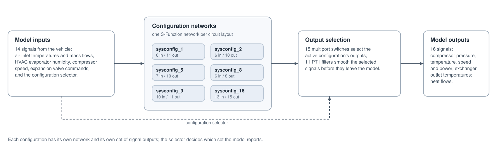
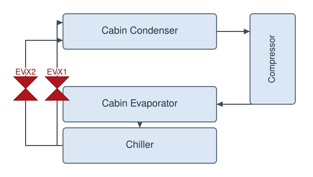

# Refrigerant circuit control concept

The refrigerant circuit of a vehicle thermal-management system changes with the hardware
variant: which expansion valve feeds which heat exchanger, whether the condenser sits at the
front end or in the cabin, and whether the cold side drives the cabin evaporator, the battery
chiller, or both. This project captures that idea in one Simulink model. Six circuit layouts
are modelled side by side, each with its own network, and a configuration selector decides
which one the model reports at runtime.

## What the model does

The model predicts the refrigerant circuit's operating point from the conditions around it.
Air-side temperatures and mass flows, the compressor speed and the expansion-valve commands
enter the model; refrigerant pressures and temperatures at the compressor, heat-exchanger
outlet temperatures and the heat flows into the air paths and the battery come out.

Every layout is a separate subsystem (`NN_sysconfig_1`, `_2`, `_5`, `_8`, `_9`, `_16`). Each
one holds a single S-Function block — the deployed network for that circuit — fed through a
demux of its own input vector, so a layout only sees the sensors it actually has. The root
model feeds all layouts in parallel and then selects the outputs of the active one with
fifteen multiport switches, one per output group.

The selector is the signal `TmeCtlConfsel_st_SysConfRefrCir_TmEP`, which arrives with the
other inputs. Eleven PT1 filter subsystems smooth the selected signals before they reach the
output ports, and data-type conversions (`single`, `double`, `int32`) match the interfaces of
the surrounding vehicle model.

## Interface

**Inputs (14).** Air inlet temperature and mass flow at the front-end condenser, the HVAC
evaporator and the heater register; the evaporator's outlet humidity; battery-chiller inlet
temperature and coolant flow; compressor speed; the commands of expansion valves EXV1 to
EXV3; and the configuration selector.

**Outputs (16).** Compressor inlet and outlet pressure and temperature, compressor speed and
electrical power; refrigerant outlet temperature at the front-end condenser and pressure and
temperature at the evaporator outlet; air outlet temperatures of the HVAC evaporator and the
heater register; and the heat flows into the front-end air, the HVAC air and the battery.

## The six configurations

| Configuration | Expansion valve(s) | Condenser | Evaporator / chiller | Network |
| --- | --- | --- | --- | --- |
| 1 | EVX3 | cabin | ambient evaporator | 6 in → 11 out |
| 2 | EVX2 | cabin | chiller | 6 in → 10 out |
| 5 | EVX1 | ambient | cabin evaporator | 7 in → 10 out |
| 8 | EVX2 | ambient | chiller | 6 in → 8 out |
| 9 | EVX2, EVX1 | ambient | cabin evaporator, chiller | 10 in → 11 out |
| 16 | EVX2, EVX1 | cabin | cabin evaporator, chiller | 13 in → 15 out |

### Configuration 1 — EVX3, cabin condenser, ambient evaporator

The smallest interface: front-end air and heater-register air on the warm side, the ambient
evaporator on the cold side, with EVX3 as the only expansion valve. Its eleven outputs cover
the compressor state, the heater register and the front-end condenser.

### Configuration 2 — EVX2, cabin condenser, chiller

The cabin condenser is combined with the battery chiller. Inputs are the chiller's coolant
temperature and flow, the heater-register air side, compressor speed and the EXV2 command;
the model reports the chiller heat flow next to the compressor state.

### Configuration 5 — EVX1, ambient condenser, cabin evaporator

The condenser moves to the front end and the cabin evaporator becomes the cold side. The
HVAC evaporator's humidity is part of this network's input vector, because the cabin air
outlet is one of its outputs.

### Configuration 8 — EVX2, ambient condenser, chiller

Front-end condenser, battery chiller and a single valve, with the shortest output list of the
six (8 signals): compressor state and power, the two heat flows and the condenser outlet.

### Configuration 9 — EVX2 and EVX1, ambient condenser, cabin evaporator and chiller

Both cold-side heat exchangers in parallel, each fed by its own expansion valve, against the
front-end condenser. Ten inputs, including both valve commands; the outputs add the cabin
evaporator's air and refrigerant states to the chiller heat flow.

### Configuration 16 — EVX2 and EVX1, cabin condenser, cabin evaporator and chiller

The most complete layout: cabin condenser, both cold-side stages and the heater register,
with thirteen inputs and fifteen outputs. It is the only configuration that reports all
three heat flows — front-end air, HVAC air and battery — at once.

## Reading the signal names

Names follow the vehicle signal convention `source_medium_variable_unit`, in German.

| Part | Meaning |
| --- | --- |
| `Eintritt` / `Austritt` | inlet / outlet |
| `KND` | front-end condenser side |
| `KaelteMittelKreis` (`KaeMK`) | refrigerant circuit side |
| `Verdampfer` | evaporator (HVAC air path) |
| `Heizregister` | heater register (HVAC air path) |
| `Chiller` / `KMKBat` | battery chiller / coolant loop to the battery |
| `EXV1` … `EXV3` | expansion valve commands |
| `EKV` | electric refrigerant compressor |
| `degC`, `bar`, `kgps`, `lpmin`, `1pmin`, `W` | °C, bar, kg/s, l/min, 1/min, W |
| `1p100` | normalised value, 0…1 = 0…100 % |

## Model facts

| | |
| --- | --- |
| Systems | 140 |
| Blocks | 1,690 (168 in the root) |
| Signal segments in the root | 368 |
| Model ports | 14 inputs, 16 outputs |
| Deployed networks | 6, one per configuration |
| Source model | `NN_Deployment.slx` |

The figures on this page are rendered from the model's own configuration drawings, so they
follow the same component order and labelling as the blocks inside each `NN_sysconfig_*`
subsystem.

---

Internal engineering documentation for the refrigerant-circuit control concept.
